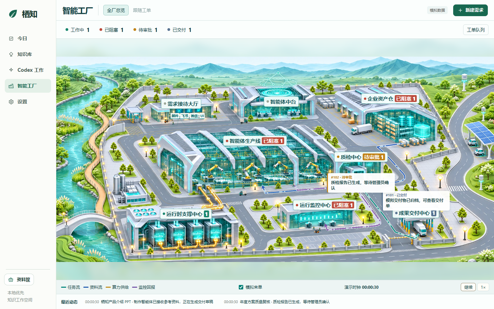
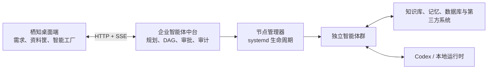

# 栖知 Qizhi

[中文](README.md) | [English](README_EN.md)

栖知是一款面向 Windows 知识工作者的本地优先工作助手。它使用内置的 NTFS/USN 索引快速发现近期文件变动，把分散的文档整理成可检索、可总结、可继续处理的工作上下文，并连接 RAGFlow、OpenAI 兼容服务、TypeSafe AI JEV 与本机 Codex CLI。

> 当前处于早期开发阶段（`0.1.1`）。接口、数据结构和安装方式仍可能变化，请先在测试环境中使用。

## 智能工厂



智能工厂把复杂的智能体工作流映射成一个可观察的园区：需求进入接待大厅，经智能体中台规划，在生产线执行，由质检中心审核，最终进入成果交付中心；企业资产仓、运行时支撑中心和运行监控中心分别承载知识资料、执行能力和运行反馈。

- **演示模式**：无需企业后端即可离线体验内置工单、状态流转、人工审批和交付过程。
- **企业模式**：在“设置 → 智能工厂”中配置企业平台地址和凭据后，展示真实工单、智能体、知识资源、运行时、质量审核与交付记录。
- **可解释操作**：地图区域、状态标签和说明面板解释当前对象及流程；关键变更仍由用户明确确认。

本仓库包含智能工厂桌面客户端。企业平台后端已拆分为独立部署，不是编译栖知桌面端的前置条件：

- `qizhi`：Windows 桌面客户端、资料筐、知识库、Codex 工作台和智能工厂界面；
- [qizhi_mg](https://github.com/frogchou/qizhi_mg)：Linux 上的控制平面、节点管理器、智能体群、协议、运维控制台和部署配置。

### 智能工厂与中台如何协作



桌面端将需求与经用户选择的资料快照提交给中台；中台规划并调度智能体，持续返回任务状态、实时输出、质量结论和可下载成果。中台的完整架构图、智能体生命周期和部署说明见 [qizhi_mg README](https://github.com/frogchou/qizhi_mg#readme) 与 [智能体编排运行手册](https://github.com/frogchou/qizhi_mg/blob/main/docs/runbooks/agent-orchestration.md)。

## 核心能力

- **今日与过去**：根据 NTFS 变更记录发现文件，按目录聚合、筛选、搜索、排序和批量选择。
- **价值评估**：使用 JEV 对符合规则的文档自动判断价值；规则与阈值由用户设置。
- **工作总结**：把选中的文件交给 OpenAI 兼容模型，按可复用提示词流式生成 Markdown 总结。
- **知识库问答**：检索 RAGFlow 知识库，同时向一个或多个 Agent 提问，展示引用资料与可下载来源。
- **Codex 工作**：基于本机 Codex CLI 管理项目和会话，将本地文件或知识库资料发送到独立任务目录，并把生成物上传回 RAGFlow。
- **本地优先与隐私控制**：扫描范围、排除目录和文件类型由用户控制；密钥保存在 Windows 凭据管理器中。

## 产品结构

| 模块        | 作用                                                   |
| ----------- | ------------------------------------------------------ |
| 今日 / 过去 | 发现、聚合和处理近期工作文件                           |
| 知识库      | RAGFlow 检索、Agent 问答、引用和资料下载               |
| Codex 工作  | 本机 Codex 项目、会话、资料和生成物管理                |
| 智能工厂    | 可视化智能体工单、资源、执行、质检、监控与交付         |
| 设置        | 扫描与隐私、模型服务、RAGFlow、JEV、Codex 与总结提示词 |

更详细的代码地图见 [桌面端说明](apps/desktop/README.md)、[前端功能模块](apps/desktop/src/features/README.md) 和 [Rust/Tauri 核心](apps/desktop/src-tauri/README.md)。

## 技术架构

```text
React + TypeScript UI
        │ Tauri commands / events
Rust application core
  ├─ NTFS/USN index service + SQLite
  ├─ RAGFlow / OpenAI / JEV HTTP clients
  ├─ Enterprise platform client (optional)
  ├─ Windows Credential Manager
  └─ Codex CLI app-server integration
```

Everything 不是运行依赖。栖知包含自己的 Windows NTFS/USN 索引服务；非 NTFS 位置和不支持的环境会按能力降级。

## 从克隆到安装包（Windows）

### 1. 安装构建环境

当前桌面端面向 Windows 10/11 x64。建议在全新 PowerShell 中依次确认以下工具：

| 工具                           | 要求                                                      |
| ------------------------------ | --------------------------------------------------------- |
| Git                            | 可使用 `git` 命令                                         |
| Node.js                        | `20.19+`，或 `22.12+`；推荐当前 LTS                       |
| pnpm                           | `11.7.0`（与根目录 `packageManager` 一致）                |
| Rust                           | 最新 stable，目标为 `stable-x86_64-pc-windows-msvc`       |
| Visual Studio Build Tools 2022 | 安装“使用 C++ 的桌面开发”、MSVC v143 与 Windows 10/11 SDK |
| WebView2 Runtime               | Microsoft Edge WebView2 Runtime                           |

安装 Rust 后可执行：

```powershell
rustup default stable-x86_64-pc-windows-msvc
npm install --global pnpm@11.7.0
```

RAGFlow、OpenAI 兼容服务、TypeSafe AI JEV、企业平台和 Codex CLI 都不是编译依赖；它们只在使用对应运行时功能时需要。Everything 也不是依赖。

### 2. 克隆并安装依赖

```powershell
git clone https://github.com/frogchou/qizhi.git
cd qizhi
pnpm install --frozen-lockfile
```

首次安装需要联网下载 npm 与 Cargo 依赖。请保留仓库中的 `pnpm-lock.yaml` 和 `apps/desktop/src-tauri/Cargo.lock`，不要自行删除锁文件。

### 3. 运行开发版本

```powershell
pnpm --filter @qizhi/desktop tauri dev
```

开发模式会启动 Vite 和 Tauri 桌面窗口。未安装本地索引服务时，文件索引功能可能显示不可用；正式安装包会在安装阶段请求管理员权限并注册该服务。

### 4. 执行验证

```powershell
pnpm check
pnpm test -- --run

Push-Location apps/desktop/src-tauri
cargo fmt --check
cargo test
Pop-Location
```

可选的 Playwright 界面测试需要本机安装 Google Chrome：

```powershell
pnpm --filter @qizhi/desktop e2e
```

### 5. 生成 Windows 安装包

```powershell
pnpm --filter @qizhi/desktop tauri build
```

该命令会先执行 TypeScript 检查和 Vite 生产构建，再编译 Rust release 程序并生成 NSIS x64 安装器。输出位于：

```text
apps/desktop/src-tauri/target/release/bundle/nsis/栖知_0.1.1_x64-setup.exe
```

安装器采用按计算机安装模式，安装内置 NTFS 索引服务时会出现 Windows UAC 确认。

### 常见构建问题

- **找不到 `link.exe`、`cl.exe` 或 Windows SDK**：在 Visual Studio Installer 中补装“使用 C++ 的桌面开发”、MSVC v143 和 Windows SDK，完成后重新打开 PowerShell。
- **找不到 `pnpm`**：重新执行 `npm install --global pnpm@11.7.0`，并确认 npm 全局可执行目录在 `PATH` 中。
- **WebView2 缺失**：安装 Microsoft Edge WebView2 Runtime 后重试。
- **首次 Cargo 构建耗时较长**：release 构建会下载并优化 Rust 依赖，数分钟属于正常情况。
- **安装服务失败**：使用管理员账户确认 UAC，并在应用“设置”中查看本地索引服务诊断。

## 配置与安全

服务地址和密钥只应通过应用的“设置”页面保存。不要把真实密钥写入 `.env`、源代码、测试、文档、日志或问题反馈。默认忽略本地数据库、日志、凭据导出、构建目录和包管理缓存。

首次安装内置索引服务需要 Windows 管理员确认。扫描仅在用户允许的目录中进行，系统目录和用户排除目录优先于允许范围。

## 仓库结构

```text
apps/desktop/              Tauri 桌面应用
  src/                     React/TypeScript 前端
    features/              今日、知识库、Codex、智能工厂、设置
  src-tauri/               Rust 核心、Windows 服务与安装配置
docs/                      架构、测试、发布与设计记录
  images/                  GitHub README 等文档图片
```

## 测试与发布

- 前端单元/组件测试：Vitest + Testing Library
- 端到端测试：Playwright
- Rust 单元/集成测试：Cargo test
- 手工发布检查：[阶段 0–1 清单](docs/testing/stage-0-1-manual-checklist.md)

提交问题时请删除日志中的文件路径、个人资料、知识库内容和服务凭据。

## 项目状态与许可证

项目正在快速迭代，欢迎通过 [GitHub Issues](https://github.com/frogchou/qizhi/issues) 提交可复现的问题和建议。

仓库目前尚未包含开源许可证。在正式公开发布前需要由项目所有者选择并添加许可证；在此之前，不自动授予复制、修改或分发代码的权利。
