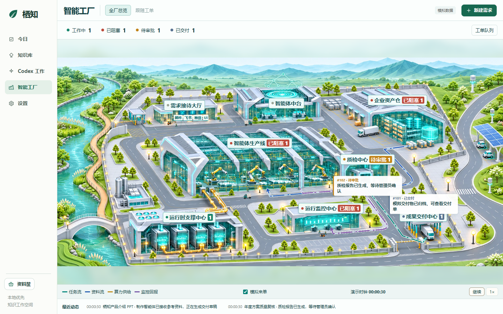
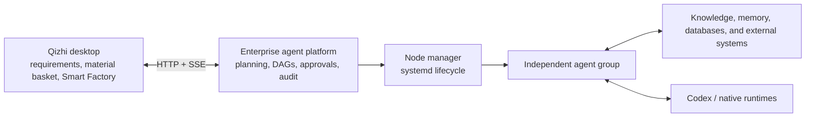

# Qizhi

[中文](README.md) | [English](README_EN.md)

Qizhi is a local-first work assistant for Windows knowledge workers. It uses a built-in NTFS/USN index to discover recent file activity, turns scattered documents into searchable and reusable work context, and integrates with RAGFlow, OpenAI-compatible services, TypeSafe AI JEV, and the local Codex CLI.

> Qizhi is currently an early-stage project (`0.1.9`). APIs, data formats, and installation behavior may change. Use it in a test environment first.

## Smart Factory



Smart Factory maps complex agent workflows onto an observable campus. Requirements enter through the reception hall, are planned by the agent hub, executed on the production line, reviewed by the quality center, and delivered through the artifact center. The asset warehouse, runtime center, and monitoring center provide knowledge, execution capacity, and operational feedback.

- **Demo mode** works offline with built-in work orders, state transitions, human approvals, and delivery flows.
- **Enterprise mode** connects to an enterprise platform configured under **Settings → Smart Factory** and displays real work orders, agents, knowledge resources, runtimes, quality reviews, and deliveries.
- On platforms that support runtime-native capabilities, new assemblies enable them by default. Codex selects native tools and skills for each task. Enterprise skills, MCP tools, business capabilities, and datasets retain their individual authorization controls.
- **Explainable operations** use map regions, status labels, and contextual guidance to explain each object and workflow while preserving explicit user confirmation for important changes.

This repository contains the Smart Factory desktop client. The enterprise platform backend is deployed separately and is not required to build Qizhi Desktop:

- `qizhi`: the Windows desktop client, material basket, knowledge features, Codex Workspace, and Smart Factory UI;
- [qizhi_mg](https://github.com/frogchou/qizhi_mg): the Linux control plane, node manager, agent group, protocol, operations console, and deployment configuration.

### How Smart Factory works with the platform



The desktop client submits requirements and user-selected material snapshots; the platform plans and schedules agents, then continuously returns task state, live output, quality conclusions, and downloadable artifacts. For the platform architecture, agent lifecycle, and deployment details, see the [qizhi_mg README](https://github.com/frogchou/qizhi_mg#readme) and the [agent orchestration runbook](https://github.com/frogchou/qizhi_mg/blob/main/docs/runbooks/agent-orchestration.md).

## Highlights

- **Today and Recent**: discover changed files from NTFS records, group them by directory, filter, search, sort, and select them in batches.
- **Value assessment**: automatically evaluate eligible documents with JEV using user-configurable criteria and thresholds.
- **Work summaries**: send selected files to an OpenAI-compatible model and stream Markdown summaries based on reusable prompt templates.
- **Knowledge Q&A**: retrieve RAGFlow knowledge, ask one or more Agents, show citations, and download source documents.
- **Codex workspace**: manage local Codex CLI projects and conversations, hand off local or RAGFlow materials to an isolated task directory, and upload artifacts back to RAGFlow.
- **Local-first privacy controls**: users control scan roots, exclusions, and file types; secrets are stored in Windows Credential Manager.

## Product Areas

| Area            | Purpose                                                                         |
| --------------- | ------------------------------------------------------------------------------- |
| Today / Recent  | Discover, group, and act on recent work files                                   |
| Knowledge       | RAGFlow retrieval, Agent Q&A, citations, and downloads                          |
| Codex Workspace | Local Codex projects, conversations, materials, and artifacts                   |
| Smart Factory   | Visualize agent work orders, resources, execution, QA, monitoring, and delivery |
| Settings        | Scan/privacy rules, model services, RAGFlow, JEV, Codex, and summary prompts    |

See the [desktop app guide](apps/desktop/README_EN.md), [frontend feature map](apps/desktop/src/features/README_EN.md), and [Rust/Tauri core guide](apps/desktop/src-tauri/README_EN.md) for implementation details.

## Architecture

```text
React + TypeScript UI
        │ Tauri commands / events
Rust application core
  ├─ NTFS/USN index service + SQLite
  ├─ RAGFlow / OpenAI / JEV HTTP clients
  ├─ Enterprise platform client (optional)
  ├─ Windows Credential Manager
  └─ Codex CLI app-server integration
```

Everything is not a runtime dependency. Qizhi ships its own Windows NTFS/USN indexing service. Non-NTFS locations and unsupported environments use capability-based fallbacks.

## From Clone to Windows Installer

### 1. Install the build toolchain

Qizhi Desktop currently targets Windows 10/11 x64. Verify the following tools in a new PowerShell session:

| Tool                           | Requirement                                                      |
| ------------------------------ | ---------------------------------------------------------------- |
| Git                            | The `git` command is available                                   |
| Node.js                        | `20.19+` or `22.12+`; the current LTS release is recommended     |
| pnpm                           | `11.7.0`, matching the root `packageManager` field               |
| Rust                           | Current stable with the `stable-x86_64-pc-windows-msvc` target   |
| Visual Studio Build Tools 2022 | Desktop development with C++, MSVC v143, and a Windows 10/11 SDK |
| WebView2 Runtime               | Microsoft Edge WebView2 Runtime                                  |

After installing Rust, run:

```powershell
rustup default stable-x86_64-pc-windows-msvc
npm install --global pnpm@11.7.0
```

RAGFlow, an OpenAI-compatible service, TypeSafe AI JEV, the enterprise platform, and Codex CLI are runtime integrations, not build dependencies. Everything is not required either.

### 2. Clone and install dependencies

```powershell
git clone https://github.com/frogchou/qizhi.git
cd qizhi
pnpm install --frozen-lockfile
```

The first install needs network access for npm and Cargo dependencies. Keep `pnpm-lock.yaml` and `apps/desktop/src-tauri/Cargo.lock`; do not delete the lockfiles.

### 3. Run the development app

```powershell
pnpm --filter @qizhi/desktop tauri dev
```

This starts Vite and the Tauri desktop window. File indexing can report unavailable when the local index service has not been installed; the production installer requests administrator approval and registers that service.

### 4. Run verification

```powershell
pnpm check
pnpm test -- --run

Push-Location apps/desktop/src-tauri
cargo fmt --check
cargo test
Pop-Location
```

The optional Playwright UI suite requires Google Chrome at its default Windows installation path:

```powershell
pnpm --filter @qizhi/desktop e2e
```

### 5. Build the Windows installer

```powershell
pnpm --filter @qizhi/desktop tauri build
```

The command runs TypeScript checks and a Vite production build, compiles the Rust release binary, and creates an x64 NSIS installer at:

```text
apps/desktop/src-tauri/target/release/bundle/nsis/栖知_0.1.9_x64-setup.exe
```

The installer uses per-machine mode. Windows displays a UAC prompt while the built-in NTFS indexing service is installed.

### Troubleshooting

- **`link.exe`, `cl.exe`, or the Windows SDK is missing**: add Desktop development with C++, MSVC v143, and the Windows SDK in Visual Studio Installer, then open a new PowerShell session.
- **`pnpm` is missing**: run `npm install --global pnpm@11.7.0` again and ensure the npm global binary directory is on `PATH`.
- **WebView2 is missing**: install Microsoft Edge WebView2 Runtime and retry.
- **The first Cargo release build takes several minutes**: downloading and optimizing Rust dependencies on the first build is expected.
- **Indexer service installation fails**: approve the UAC prompt with an administrator account and review the local indexer diagnostics under Settings.

## Configuration and Security

Save service URLs and API keys only through the in-app Settings page. Never place real keys in `.env` files, source code, tests, documentation, logs, or issue reports. Local databases, logs, credential exports, build output, and package-manager caches are ignored by default.

Installing the built-in indexing service requires Windows administrator confirmation. Scanning is limited to user-approved roots, while system and user exclusions always take precedence.

## Repository Layout

```text
apps/desktop/              Tauri desktop application
  src/                     React/TypeScript frontend
    features/              Today, Knowledge, Codex, Smart Factory, and Settings
  src-tauri/               Rust core, Windows service, and installer configuration
docs/                      Architecture, testing, release, and design records
  images/                  Images used by GitHub READMEs and other documentation
```

## Testing and Release

- Frontend unit/component tests: Vitest + Testing Library
- End-to-end tests: Playwright
- Rust unit/integration tests: Cargo test
- Manual release checks: [Stage 0–1 checklist](docs/testing/stage-0-1-manual-checklist.md)

Remove file paths, personal information, knowledge-base content, and credentials from logs before filing an issue.

## Project Status and License

Qizhi is under active development. Reproducible bugs and proposals are welcome in [GitHub Issues](https://github.com/frogchou/qizhi/issues).

This repository does not yet include an open-source license. The project owner must select and add one before a formal public release; until then, no permission to copy, modify, or distribute the code is granted automatically.
